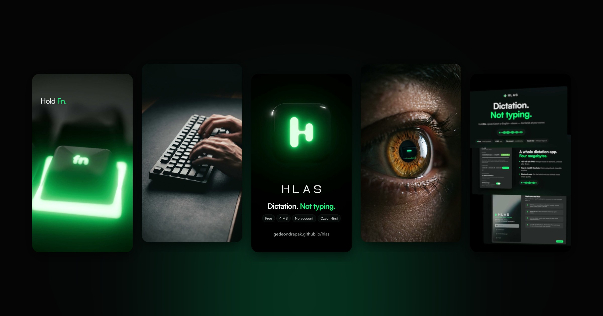
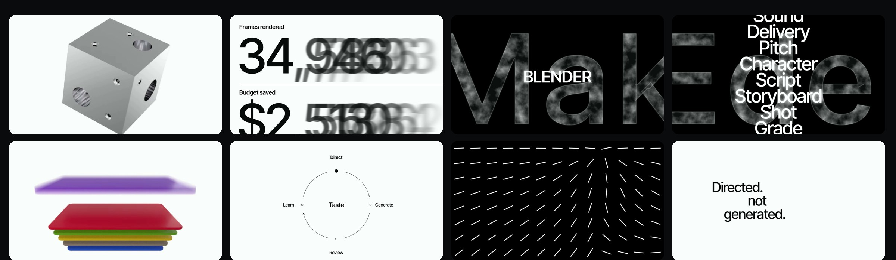
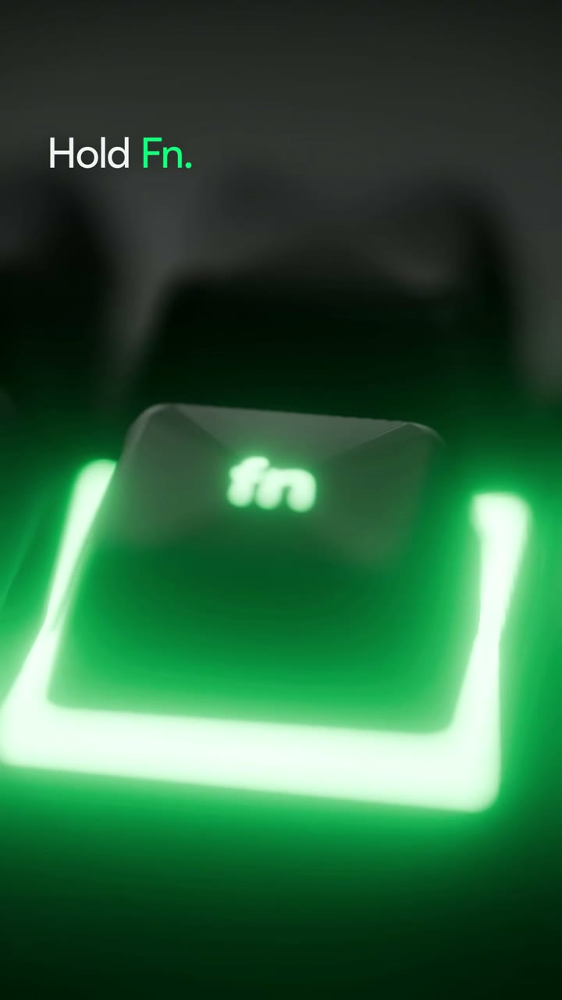
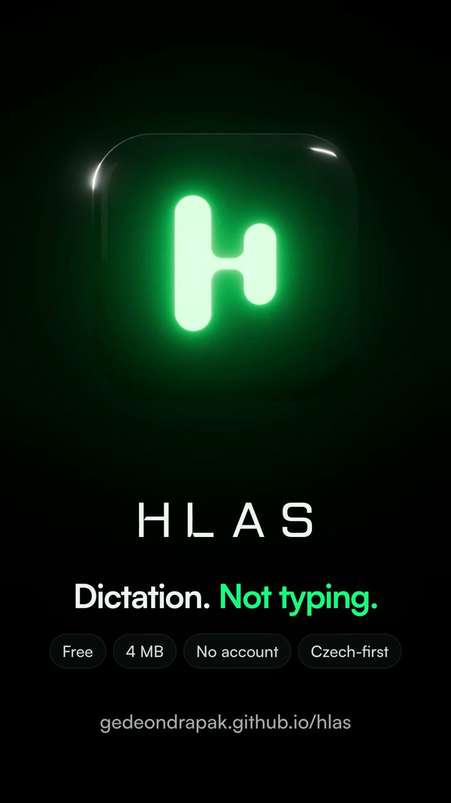
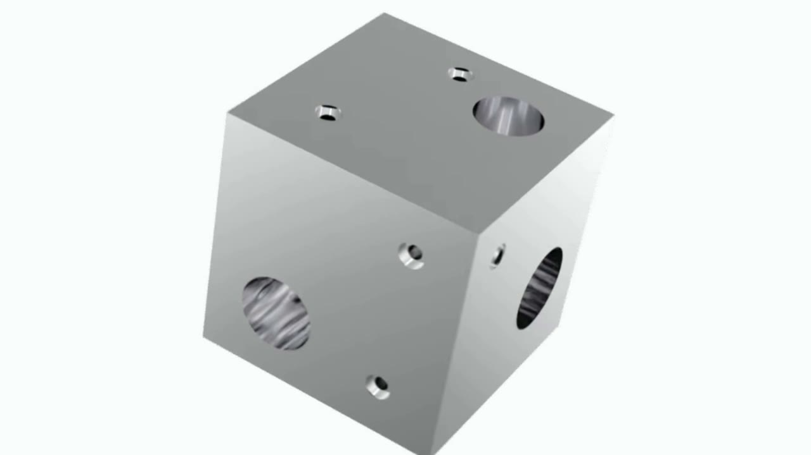
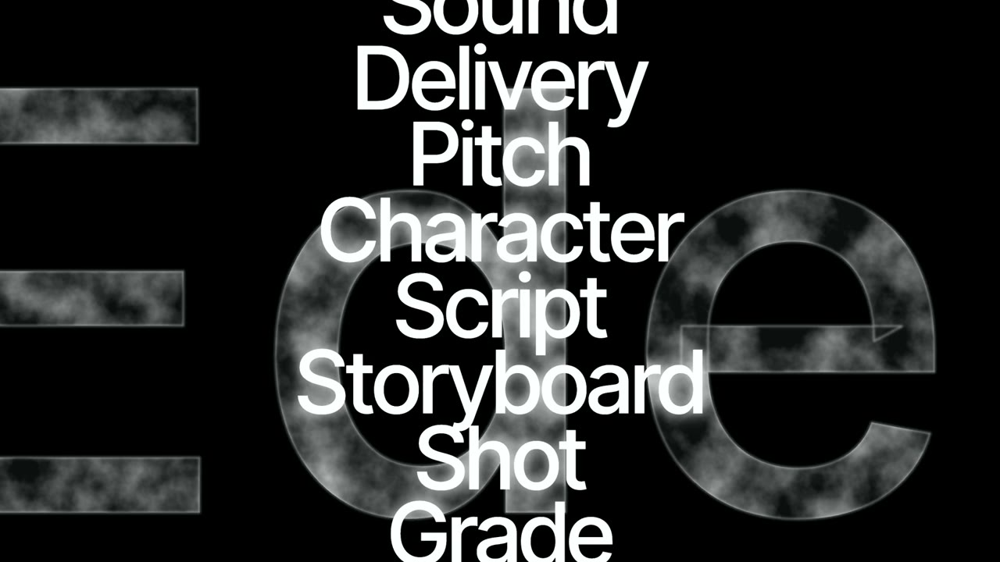

<div align="center">



# eden-motion

**Company name in, finished motion-graphics film out.**
An agent-driven pipeline for premium brand films, launch videos and explainers: real 3D, true motion blur, layered sound, and a director loop that watches its own frames.

**[Website and showcase](https://eden-makers.github.io/eden-motion/)** · [Quick start](#quick-start) · [How it works](#how-it-works) · [For agents](#driving-it-with-an-agent)

<sub>by <a href="https://edenmakers.ai">Edenmakers</a>, an AI film and advertising studio in Prague · <i>Directed. Not generated.</i></sub>

</div>

---

eden-motion turns a brief (a company name, a URL, or a hand-written storyboard) into a finished,
mixed MP4. It researches the brand, writes the script, records the voiceover, storyboards the shots
from a library of 31 parameterised scenes, renders 3D plates headless in Blender, builds a layered
sound mix, renders with **true shutter motion blur**, then critiques its own frames and iterates.
Every step is plain JSON in a project folder, so Claude Code, Codex, Gemini CLI, Cursor or a human
can stop at any step, edit, and continue.



## What is inside

- **31 scene types, 16 transitions, 4 house styles.** Kinetic and editorial type, product UI with
  camera and cursor, counters, diagrams (timeline, quadrant, flywheel, sequence, nested), glass
  orbs, card clouds, logo lockups. Styles: `burnwe` (SaaS explainer), `launch` (launch film),
  `higgsfield` (grid promo), `relate` (editorial metronome cuts on a fixed grid).
- **Real 3D through Blender, headless.** `blender:` props render transparent plates: machined chrome
  hardware, acrylic card stacks, and `layers-3d`, which puts your 2D assets (screenshots, stills,
  rendered layers, video) into real 3D space for true depth of field, rack focus, rotation and
  parallax that CSS 3D cannot do.
- **True motion blur.** HyperFrames seeks frame by frame, so eden-motion stretches time where things
  move fast, captures sub-frames and averages them with a real 180 degree shutter.
- **Layered sound.** Voiceover, music, ambience and four SFX layers render to separate stems
  (drop them straight into your editor) and a mastered mix at -14 LUFS. Sound effects come from
  5M+ free CC0 / CC-BY sounds on Openverse, scored in code; optional stingers are composed in code
  in the music's detected key. `remix` rebalances the stems in a second.
- **A director loop.** `critique` makes contact sheets, a phone-size test and frame strips around
  every cut, measures pops and dead air, scores against a harsh rubric, and appends a review log.
- **Rebuild any reference 1:1.** `ref` measures a film's cuts and style, `compare` puts your render
  next to it with SSIM, `critique --against` scores both with the same rubric.
- **Any frame size.** 16:9 films and 1080x1920 reels from the same engine.
- **Motion that never feels like software.** No linear moves by default: arrivals are focus pulls,
  drifts ease out into the cut, everything is deterministic and seekable.

## Showcase

| | |
|---|---|
|   | **Hlas, a 43 s vertical promo** for a Czech-first dictation app. Keycaps that drift apart and a Fn key that lights up green are Blender plates; the dictated Czech sentence lands at the cursor on release, exactly like the app; the real app screens are flown in 3D with a rack focus. Music, foley and a logo sting in the music's key. [Watch](https://eden-makers.github.io/eden-motion/#hlas) |
|   | **Editorial metronome test.** Cuts every 24 frames, polarity flips, a chrome block rendered in Cycles, ghost counters, frosted glass letters, a logo built from its own bars. [Watch](https://eden-makers.github.io/eden-motion/#editorial) |

## Quick start

**In Claude Code** (two commands, then just ask for a film):

```
/plugin marketplace add Eden-Makers/eden-motion
/plugin install eden-motion@eden-motion
```

Then say *"set up eden-motion"*: the agent runs `doctor`, installs what is missing, has you paste
API keys into a masked prompt in your own terminal (never into the chat) and renders a 7 s smoke
test. After that: *"make a 45 second launch film for Linear"*.

**From a terminal** (Claude Code, Codex, Gemini CLI, Cursor, opencode):

```bash
git clone https://github.com/Eden-Makers/eden-motion && cd eden-motion
./install.sh            # npm deps, skill links for Claude Code / Codex / Agent Skills, global CLI
eden-motion setup       # checks tools, asks for missing keys (masked), verifies them, 7 s smoke render
eden-motion new "Attio" --url https://attio.com --duration 45
# about 25-40 min later: projects/attio/renders/final.mp4 + review/index.html
```

Requirements: macOS (Apple Silicon tested; Linux should work), Node 20+, ffmpeg, Chrome (or the Puppeteer headless shell), a
`GEMINI_API_KEY` (free tier works). Recommended: `ELEVENLABS_API_KEY` for voice and music.
Optional: Blender 4.2+ for 3D plates, `uv` for code-composed stingers. `eden-motion doctor` tells you
what is missing and why.

## How it works

```
brief.json ─ research ─► brand.json + logo, fonts, screenshots      Gemini + search, headless capture
           ─ script ───► script.json (beats, one clause per shot)
           ─ vo ───────► voiceover + word timings                    ElevenLabs
           ─ storyboard► storyboard.json (scene per shot, props, tones, transitions, sounds)
           ─ assets ───► images for "gen:" props                      Nano Banana Pro
           ─ blender ──► transparent 3D plates for "blender:" props   Blender headless
           ─ audio ────► stems/ + mix.wav (VO, music, ambience, SFX layers, stingers)
           ─ render ───► final.mp4 (HyperFrames + time-stretched capture + shutter blur)
           ─ critique ─► sheets + scores + review_log.md; fix, re-render, repeat
           ─ review ───► review/index.html (frames per shot, VO, props, prompts)
```

Useful commands: `storyboard --variants 3`, `stills` (one settled frame per scene before rendering
motion), `note "<director notes>"`, `remix --music -3 --sfx +2`, `compare <ref.mp4>`,
`critique --against <ref.mp4>`, `render --draft`. Run `eden-motion help` for all of them.

## Driving it with an agent

`install.sh` links `skills/eden-motion` into `~/.claude/skills`, `~/.codex/skills` and
`~/.agents/skills`. Then just ask: *"make a 45 second launch video for Linear"*, *"rebuild this
reference 1:1"*, *"a vertical promo for my app, here is my moodboard"*. The skill teaches the agent
the whole loop: onboard the user from `doctor --json`, write and fix the script, look at frames,
run the critique, never ship the first render. Scene authors: see `runtime/SCENE_API.md`.

## Research

The defaults come from measuring films, not from taste alone: `research/analysis/` holds forensic
breakdowns (90+ techniques with parameters: easing, timing, type, sound), `research/relate/` 26
per-film shot lists, `research/blender/` a Blender headless playbook, and an analysis of 703 public
Opus 5.5 video prompts.

## Credits

Built on [HyperFrames](https://github.com/heygen-com/hyperframes), [GSAP](https://gsap.com),
[Blender](https://www.blender.org), [ffmpeg](https://ffmpeg.org),
[Openverse](https://openverse.org) and [audio-as-code](https://github.com/joaoCarvalho1000/audio-as-code).
Bundled sound effects in `sfx-library/` are from [Pixabay](https://pixabay.com/sound-effects/)
under the Pixabay Content License (see `sfx-library/CREDITS.md`). Model providers: Google Gemini,
ElevenLabs, optional fal / Higgsfield for AI video.
