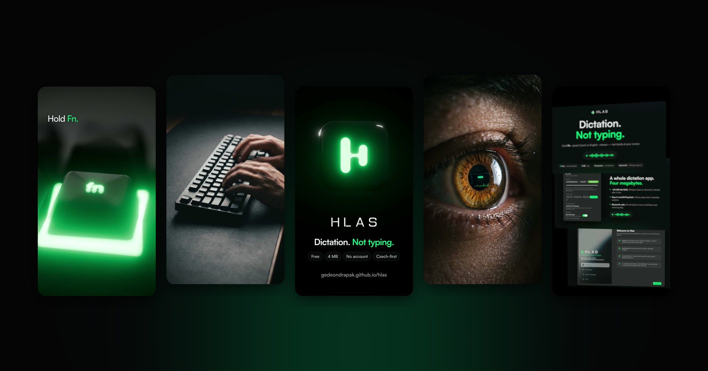
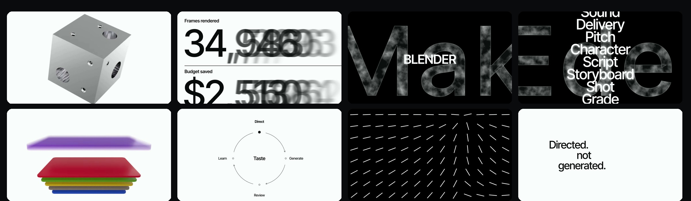
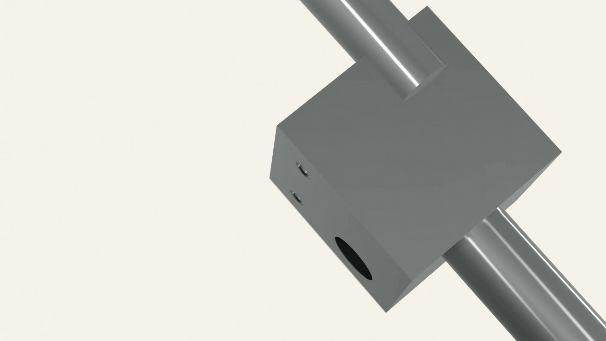
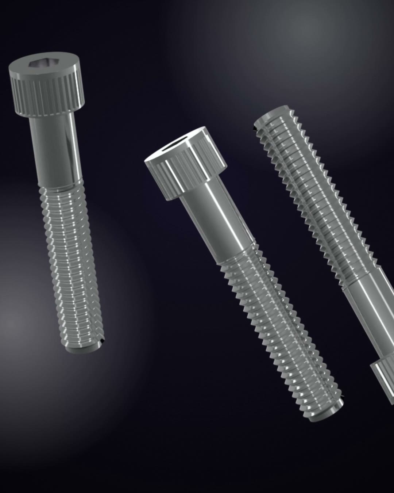
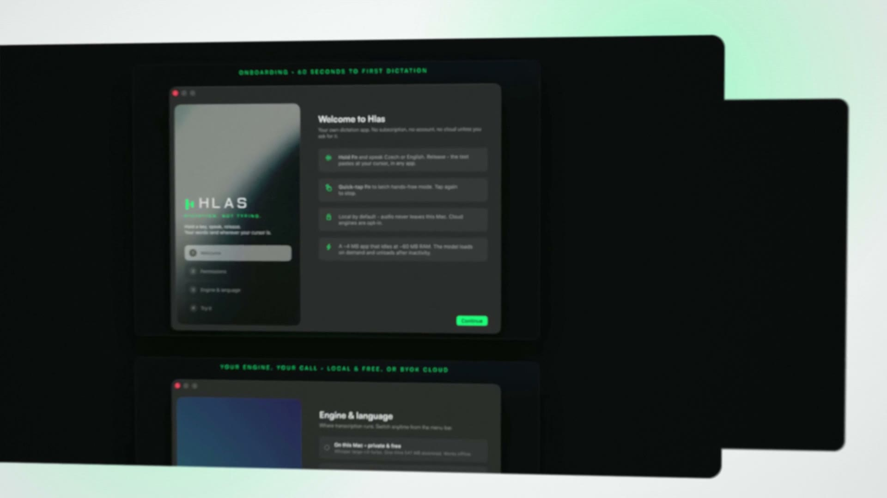
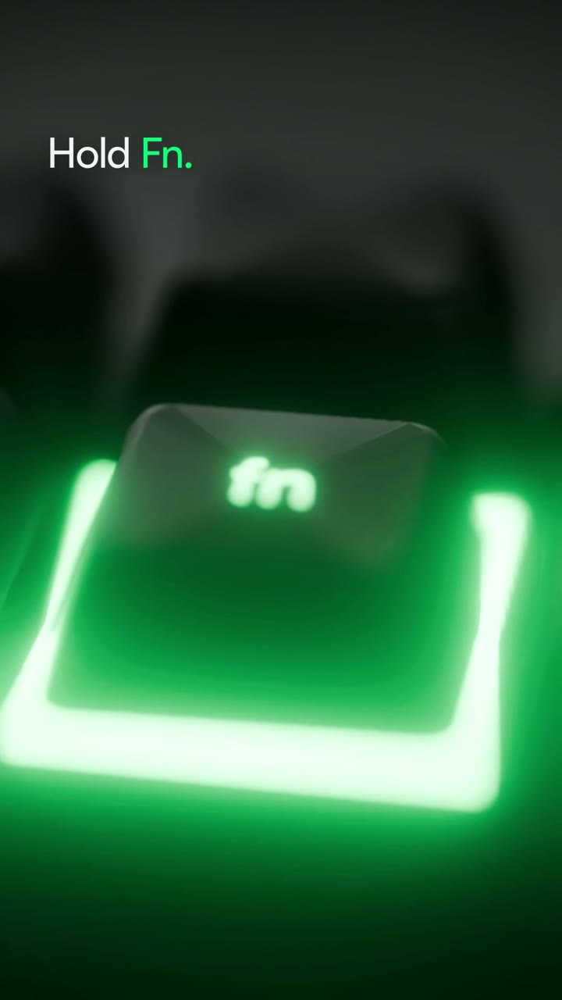
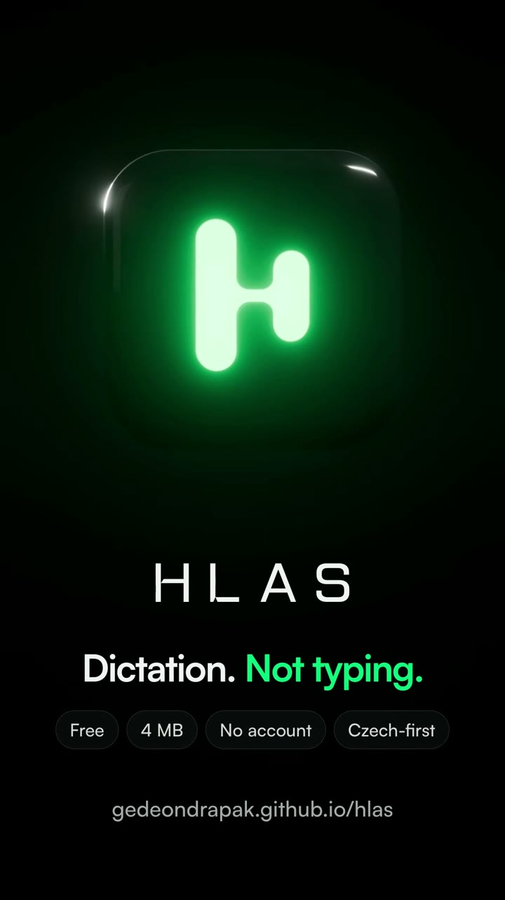
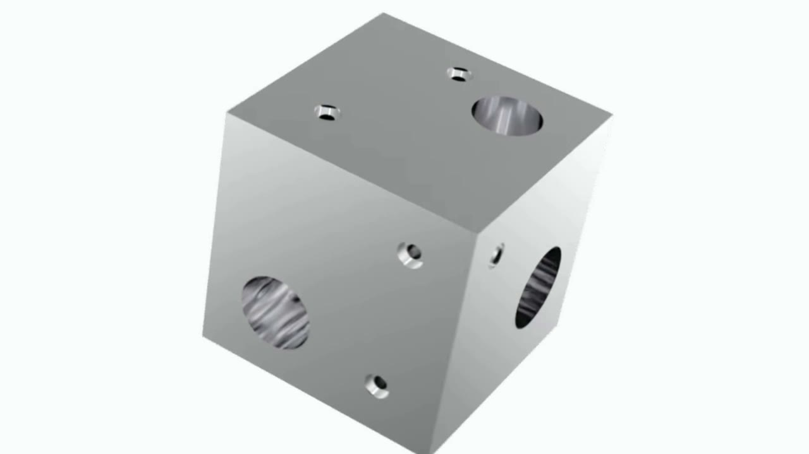
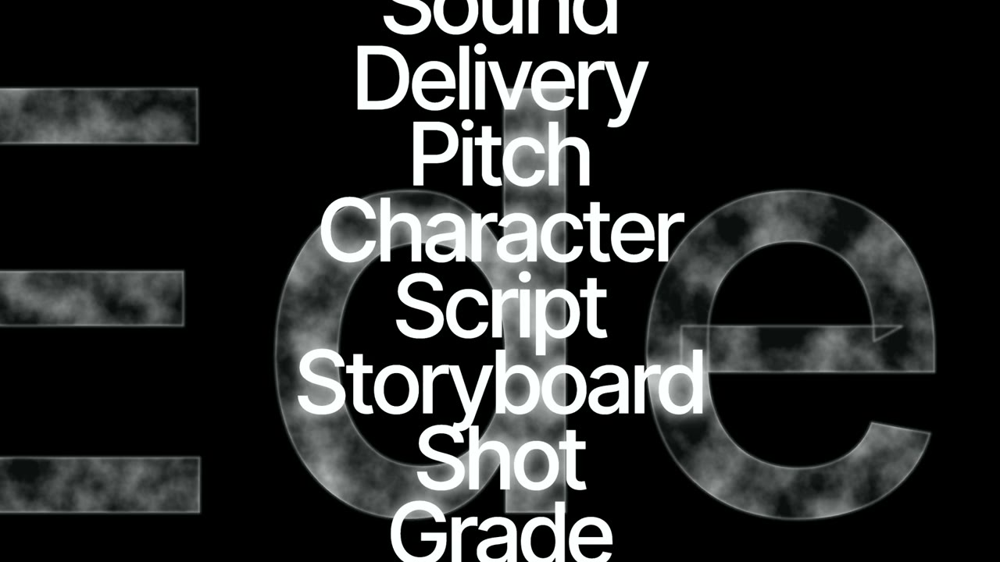

<div align="center">



# eden-motion

**Company name in, finished motion-graphics film out.**
An agent-driven hybrid motion pipeline for premium brand films, launch videos and explainers: crisp 2D HTML/GSAP, seek-deterministic WebGL2/Three.js shaders, headless Blender 3D with optical DOF, true motion blur, layered sound, and a verification loop that measures its own frames.

**[Website and showcase](https://eden-makers.github.io/eden-motion/)** · [Quick start](#quick-start) · [How it works](#how-it-works) · [For agents](#driving-it-with-an-agent)

<sub>by <a href="https://edenmakers.ai">Edenmakers</a>, an AI film and advertising studio in Prague · <i>Directed. Not generated.</i></sub>

</div>

---

eden-motion turns a brief (a company name, a URL, or a hand-written storyboard) into a finished,
mixed MP4. It researches the brand, writes the script, records the voiceover, runs a pre-storyboard
creative treatment gate, storyboards shots from a library of **50 parameterised scenes**, drives
**seek-deterministic WebGL2 shaders**, renders **headless Blender 3D plates**, builds a layered
sound mix, renders with **true shutter motion blur**, then critiques and measures its own frames.
Every step is plain JSON in a project folder, so Claude Code, Codex, Gemini CLI, Cursor or a human
can stop at any step, edit, and continue.



## What is inside

- **50 scene types, 16 transitions, 7 backgrounds, 5 house styles, 5 short-form templates.** Kinetic
  and editorial type, borderless flat macro UI (`macro-ui`, `ui-window`), CLI/MCP terminals (`terminal`),
  streaming AI answers (`answer-stream`), live telemetry tickers (`micro-ticker`), WebGL2 3D globes
  (`webgl-globe`) and iridescent foil cards (`shader-card`), counters, diagrams, glass orbs, card
  clouds, and logo lockups. Styles (each backed by a measured `profile.json` and 11-section `style.md`
  bible): `burnwe`, `launch`, `higgsfield`, `relate`, and `ovyon`. Short-form 20-30 s templates:
  `--template launch|feature-drop|changelog|product-tour|pitch`.
- **Hybrid 4-engine architecture.** Routes every shot to the right stack (`skills/eden-motion/references/hybrid-tech-matrix.md`):
  1. **2D HTML/GSAP** for subpixel typography, flat macro UI close-ups, terminals, and live-captured UI twins.
  2. **Seek-deterministic WebGL2 / Three.js** (`runtime/webgl.js`) for continuous GPU shader backgrounds (`shader-silk`, `shader-mesh`, `shader-grid`, `shader-dither`) and scenes (`webgl-globe`, `shader-card`) with zero Blender wait.
  3. **Headless Blender 3D** (`blender:` props) for photoreal chrome/acrylic hardware and `layers-3d` with true optical DOF, rack focus, wide-lens wraparound walls, and mathematically seamless loops (`stack`, `tower`, `row`, `fan`, `floor`, `carousel`, `wall`, `fisheye-wall`, `exploded` + `loop=1`).
  4. **Selective AI / live footage** only where organic human/world shots beat CG.
- **Pre-storyboard treatment gate.** `treatment <slug>` generates 3 structurally distinct creative
  treatments with explicit hybrid tech mix budgets, signature hero shot, polarity rule, and a 4-of-6
  novelty check against your previous project (`--pick <n>` locks the chosen direction before storyboarding).
- **Live UI capture & frame-level fidelity verification (Reanimate engine).** `clone-ui <slug> <url>`
  captures any live web widget under a deterministic virtual clock, fits element easing curves and
  optional WebGL uniforms, and generates a deterministic `EM.scene` starter. `compare --at` runs
  pixelmatch + activity-curve alignment with `--fidelity motion|pixel|mixed`, `--blur`, `--region`,
  and a 3-row `REF | CLONE | DIFF` sheet. `measure` checks reading times, framing, ease tails, and
  element easing curves.
- **True motion blur.** HyperFrames seeks frame by frame, so eden-motion stretches time where things
  move fast, captures sub-frames and averages them with a real 180 degree shutter.
- **Layered sound.** Voiceover, music, ambience and four SFX layers render to separate stems
  (drop them straight into your editor) and a mastered mix at -14 LUFS. Sound effects come from
  5M+ free CC0 / CC-BY sounds on Openverse, scored in code; optional stingers are composed in code
  in the music's detected key. `remix` rebalances the stems in a second.
- **Director & review workflows.** `critique` runs a harsh watch-your-own-frames rubric; `review`
  builds an HTML review sheet, exports `videohub.json` (`--videohub`, with timecode markers,
  thumbnails, and audio stems), and imports timestamped VideoHub/CRM comments mapped directly to
  scene IDs (`--import-notes comments.json`) ready for `eden-motion note`.
- **Learn a style from many films.** `study <style> <films...>` measures a set of references and
  keeps the ranges they agree on (shot lengths, cut rate, holds, polarity, look, beat sync).
- **Any frame size.** 16:9 films, 4:5 / 1:1 feeds, and 1080x1920 reels from the same engine.

## Showcase

Three films rendered end to end from a company name and a few lines of notes, no generated stills
(type, product UI, diagrams and Blender plates), each checked frame by frame with `measure`:

| | |
|---|---|
|  | **eden-motion launch film**, 16:9, 39 s, relate style. Metronome cuts on a 24 frame grid, chrome hardware rendered headless in Blender, the website flown through with real depth of field, a logo built from its own bars. [Watch](https://eden-makers.github.io/eden-motion/#eden-motion) |
|  | **Edenmakers studio film**, 4:5, 33 s, launch style. Laid out on a 1728 x 2160 stage, delivered at 1080 x 1350. [Watch](https://eden-makers.github.io/eden-motion/#edenmakers) |
|  | **Hlas product demo**, 16:9, 36 s, burnwe style. The real app screens in Blender with a dolly and rack focus, cuts snapped to the music. [Watch](https://eden-makers.github.io/eden-motion/#hlas-demo) |
Earlier tests:

| | |
|---|---|
|   | **Hlas, a 43 s vertical promo** for a Czech-first dictation app. Keycaps that drift apart and a Fn key that lights up green are Blender plates; the dictated Czech sentence lands at the cursor on release, exactly like the app; the real app screens are flown in 3D with a rack focus. Music, foley and a logo sting in the music's key. [Watch](https://eden-makers.github.io/eden-motion/#hlas) |
|   | **Editorial metronome test.** Cuts every 24 frames, polarity flips, a chrome block rendered in Cycles, ghost counters, frosted glass letters, a logo built from its own bars. [Watch](https://eden-makers.github.io/eden-motion/#editorial) |

## Quick start

**In Claude Code** (two commands, then just ask for a film):

```
/plugin marketplace add Eden-Makers/eden-motion
/plugin install eden-motion@eden-motion
```

Then say *"set up eden-motion"*: the agent runs `doctor`, installs what is missing, has you paste
API keys into a masked prompt in your own terminal (never into the chat) and renders a 7 s smoke
test. After that: *"make a 45 second launch film for Linear"*.

**From a terminal** (Claude Code, Codex, Gemini CLI, Cursor, opencode):

```bash
git clone https://github.com/Eden-Makers/eden-motion && cd eden-motion
./install.sh            # npm deps, skill links for Claude Code / Codex / Agent Skills, global CLI
eden-motion setup       # checks tools, asks for missing keys (masked), verifies them, 7 s smoke render
eden-motion new "Attio" --url https://attio.com --duration 45
# about 25-40 min later: projects/attio/renders/final.mp4 + review/index.html
```

Requirements: macOS (Apple Silicon tested; Linux should work), Node 20+, ffmpeg, Chrome (or the Puppeteer headless shell), a
`GEMINI_API_KEY` (free tier works). Recommended: `ELEVENLABS_API_KEY` for voice and music.
Optional: Blender 4.2+ for 3D plates, `uv` for code-composed stingers. `eden-motion doctor` tells you
what is missing and why.

## How it works

```
brief.json - research  -> brand.json + logo, fonts, screenshots       Gemini + search, headless capture
           - script    -> script.json (beats, one clause per shot)
           - vo        -> voiceover + word timings                    ElevenLabs
           - treatment -> 3 creative treatments + hybrid tech mix     --pick <n> locks chosen direction
           - clone-ui  -> live web UI capture + deterministic twin    Reanimate virtual clock + curve fit
           - storyboard-> storyboard.json (50 scenes, WebGL shaders, style.md bible, 5 short templates)
           - assets    -> images for "gen:" props                     Nano Banana Pro
           - blender   -> transparent 3D plates for "blender:" props  Blender headless (9 layers-3d layouts + loop)
           - audio     -> stems/ + mix.wav (VO, music, ambience, SFX layers, stingers)
           - render    -> final.mp4 (HyperFrames + time-stretched capture + shutter blur)
           - critique  -> sheets + scores + measure + review_log.md; fix, re-render, repeat
           - review    -> review/index.html + videohub.json + --import-notes timestamped CRM comments
```

Useful commands: `treatment <slug> [--pick n]`, `clone-ui <slug> <url>`, `storyboard --style ovyon --template launch`,
`storyboard --variants 3`, `stills`, `note "<director notes>"`, `remix --music -3 --sfx +2`,
`compare <slug> <ref.mp4> --at 0:04-0:08 --fidelity motion`, `review <slug> --videohub`,
`review <slug> --import-notes comments.json`, `render --draft`. Run `eden-motion help` for all of them.

## Driving it with an agent

`install.sh` links `skills/eden-motion` into `~/.claude/skills`, `~/.codex/skills` and
`~/.agents/skills`. Then just ask: *"make a 45 second launch video for Linear"*, *"clone the pricing
toggle on linear.app into a deterministic scene"*, *"rebuild this reference 1:1"*, *"a vertical promo
for my app, here is my moodboard"*. The skill teaches the agent the whole loop: onboard the user from
`doctor --json`, run the treatment gate, route shots across the hybrid 4-engine matrix, look at frames,
run measure + critique, never ship the first render. Scene authors: see `runtime/SCENE_API.md`.

## Research

The defaults come from measuring films, not from taste alone: `research/analysis/` holds forensic
breakdowns across 80+ measured films (`universal-craft-invariants.md`, `higgsfield-mcp-closeup.md`,
plus 90+ techniques with parameters: easing, timing, type, sound), `styles/*/style.md` holds 11-section
style bibles for all 5 house styles, `research/relate/` 26 per-film shot lists, `research/blender/` a
Blender headless playbook, and an analysis of 703 public Opus 5.5 video prompts.

## License

Apache License 2.0, copyright Eden Makers s.r.o. See [LICENSE](LICENSE) and [NOTICE](NOTICE):
the bundled Pixabay sound effects keep their own licence, and the licence grants no rights to the
Edenmakers, eden-motion or Hlas names and marks.

## Credits

Built on [HyperFrames](https://github.com/heygen-com/hyperframes), [GSAP](https://gsap.com),
[Blender](https://www.blender.org), [ffmpeg](https://ffmpeg.org),
[Openverse](https://openverse.org), [audio-as-code](https://github.com/joaoCarvalho1000/audio-as-code),
and [reanimate](https://github.com/NiazMorshed2007/reanimate) (MIT).
Bundled sound effects in `sfx-library/` are from [Pixabay](https://pixabay.com/sound-effects/)
under the Pixabay Content License (see `sfx-library/CREDITS.md`). Model providers: Google Gemini,
ElevenLabs, optional fal / Higgsfield for AI video.
